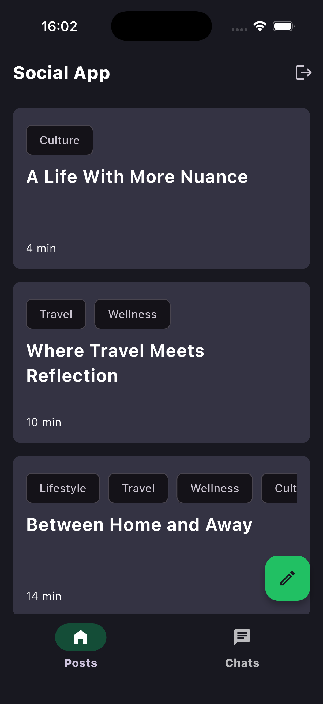
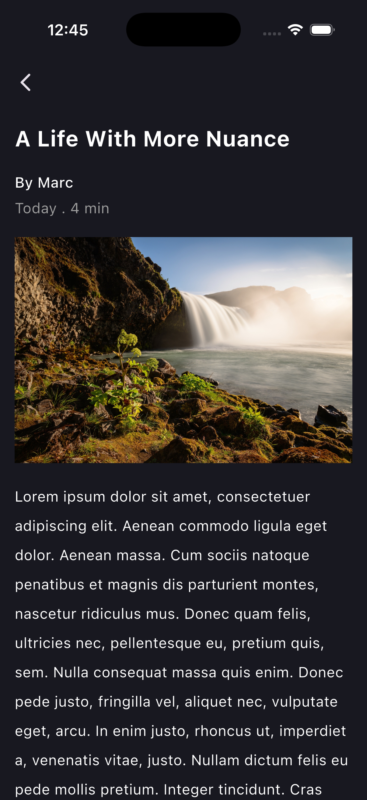
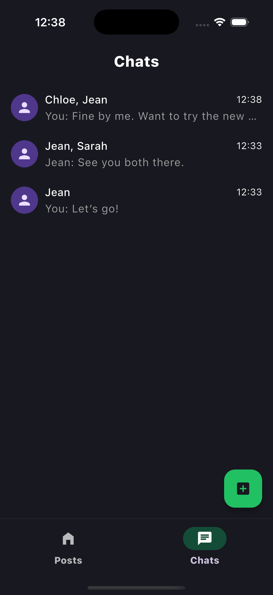
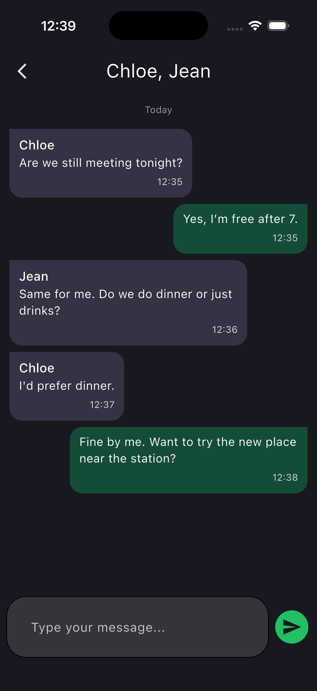

# Social App

[](https://sonarcloud.io/summary/new_code?id=Tevinar-Sindbad_social_app)

A Flutter Android/iOS application demo using a custom NestJS API and Supabase Auth (both present in `social_app_backend` repository).

## 1. Overview

Social App currently covers four main capabilities:

- email/password authentication with Supabase Auth and email confirmation
- profile onboarding after the first authenticated session
- post publishing with image upload, cache-first reading and cursor-paginated feed
- chats with cursor-paginated reads and server-pushed SSE updates

The repository is intended as a technical codebase organized around explicit
architectural boundaries.

Learn more about architecture in [architecture.md](./architecture.md).

## 2. Visual Overview

<p align="center">
  
  
  
  
</p>

## 3. Tech Stack

- Dart / Flutter
- Custom Nest backend API with Supabase Auth
- Drift / SQLite and disk-backed image caching for local persistence
- BLoC-based feature state and orchestration
- Sentry for monitoring

## 4. CI

- `.github/workflows/quality-checks.yml`: runs on pull requests and pushes to
  `main`; checks codegen, lockfile consistency, formatting, static analysis,
  tests with coverage, SonarQube, and Android / iOS debug build validation
- `.github/workflows/release-validation.yml`: runs on version tags; validates
  Android and iOS release builds

## Testing

The repository currently includes a small set of representative tests as the
initial testing reference for this architecture.

Current examples exist in:

- `features/profile/**`
- `app/**`
- `core/**`

These tests are meant to demonstrate the intended approach for:

- unit tests
- framework/glue tests

See [architecture.md](./architecture.md) for the full testing strategy.

## 4. Getting Started

### Prerequisites

You need:

- Flutter SDK
- a working Flutter toolchain for your target platform

The repository defines the expected Flutter version in
[`pubspec.yaml`](./pubspec.yaml), and CI reads the version from there.
Use the same Flutter version locally to avoid CI/local mismatches in
dependency resolution, analysis, generated files, and builds.

### Installation

```bash
git clone https://github.com/Tevinar-Sindbad/social_app.git
cd social_app
flutter pub get
```

### Start the application (VS Code version)

Before the first run, run:

```sh
cp .vscode/launch.example.json .vscode/launch.json
```

Then replace `SUPABASE_PUBLISHABLE_KEY` in `.vscode/launch.json` with the real publishable key of
the local Supabase project tracked in [`social_app_backend`](../social_app_backend/README.md). You
will find the procedure to get it in section "Create local configuration one time".

Start the local backend and Supabase stack from
[`social_app_backend`](../social_app_backend/README.md), then run one of the configurations in
`.vscode/launch.json`.

### Start the application (manually)

Before the first run, get the supabase publishable key of the local Supabase project tracked in
[`social_app_backend`](../social_app_backend/README.md). You will find the procedure to get it in section "Create local configuration one time".

Start the local backend and Supabase stack from
[`social_app_backend`](../social_app_backend/README.md), then run:

```sh
flutter run \
  --dart-define=APP_ENV=local \
  --dart-define=SUPABASE_URL=http://127.0.0.1:54321 \
  --dart-define=SUPABASE_PUBLISHABLE_KEY=replace-with-your-supabase-publishable-key \
  --dart-define=SUPABASE_EMAIL_REDIRECT_URL=socialapp://auth-callback \
  --dart-define=BACKEND_BASE_URL=http://localhost:3000 \
  --dart-define=SENTRY_RELEASE=local-dev \
  --dart-define=SENTRY_TRACES_SAMPLE_RATE=1.0
```

### Android emulator networking

Run these commands while the Android emulator is running:

```sh
adb reverse tcp:3000 tcp:3000
adb reverse tcp:54321 tcp:54321
adb reverse tcp:4443 tcp:4443
```

This creates reverse port tunnels from the emulator back to your computer. In
practice:

- connections to `localhost:3000` inside Android are forwarded to port `3000`
  on your Mac for `social_app_backend`
- connections to `localhost:54321` inside Android are forwarded to port
  `54321` on your Mac for Supabase Auth
- connections to `localhost:4443` inside Android are forwarded to port `4443`
  on your Mac for fake-GCS container

### Test email verification

Open Mailpit in your browser:

```text
http://127.0.0.1:54324
```

Open the new email and copy the full confirmation URL.

iOS Simulator:

```sh
xcrun simctl openurl booted "PASTE_THE_FULL_CONFIRMATION_LINK_HERE"
```

This opens the confirmation link in the iOS Simulator so the app redirect can
complete.

Android emulator:

```sh
adb shell "am start -W -a android.intent.action.VIEW -d 'PASTE_THE_FULL_CONFIRMATION_LINK_HERE'"
```
